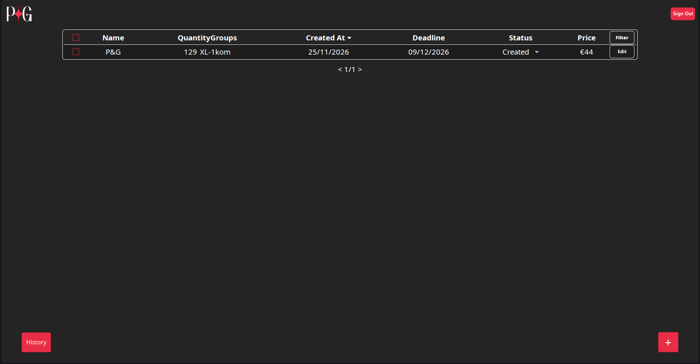

# pg-orders-management-service



## Goal

`pg-orders-management-service` is an order-management microservice for print and manufacturing workflows that tracks named orders, size-based quantity groups, deadlines, prices, and lifecycle status. It exposes a REST API over ASP.NET Core for creating, reading, updating, deleting, and paginating orders backed by SQL Server, with a React frontend for interactive order management. All routes except the health probe are gated by an `X-API-Key`.

## Architecture & Tech Stack

The repository is a monorepo: `backend/` holds the production .NET API, `frontend/` holds a Vite + React UI that consumes the API, and `docker-compose.yml` at the root orchestrates SQL Server, the API, and the frontend. The backend is a two-project solution (`backend/OrdersManagement.sln`) with strict separation between HTTP transport in `WebAPI` and persistence plus business logic in `Service`. Controllers delegate to `IOrderService`; Entity Framework Core 9 handles mapping, querying, and migrations, which run automatically on startup.

- **WebAPI Layer** — `backend/WebAPI`: `OrderController`, `ApiKeyMiddleware`, `GlobalExceptionHandler`, Swagger, health checks, rate limiting, CORS, forwarded headers, and DI wiring in `backend/WebAPI/Program.cs`.
- **Service Layer** — `backend/Service`: `ApplicationDbContext`, entities, DTOs, `OrderMapper`, `OrderService`, and EF Core migrations.
- **Data Layer** — SQL Server persistence of the `Orders` aggregate (`Order`, `OrderQuantityGroup`, `OrderQuantity`) through `ApplicationDbContext` in `backend/Service/Data/ApplicationDbContext.cs`.
- **DTO Layer** — `CreateOrderDTO`, `UpdateOrderDTO`, `OrderDto`, `OrderQueryParameters`, and `PagedResult<T>` with data-annotation validation in `backend/Service/DTO/`.
- **Mapping Layer** — entity↔DTO conversions via `backend/Service/Mappers/OrderMapper.cs`.
- **Business Logic Layer** — CRUD, filtered and sorted paged listing, and group/quantity sync on update in `backend/Service/Services/OrderService.cs`.
- **Frontend** — `frontend/`: Vite + React SPA with API-key cookie auth, paginated data table with sorting and status filtering, create/edit order forms, and multi-order delete; production build served by nginx.
- **Operations** — `docker-compose.yml` (`db`, `api`, `frontend` services) and `backend/Dockerfile` (multi-stage publish).

### Project Stack Breakdown

- **Backend:** `ASP.NET Core` (`Microsoft.NET.Sdk.Web`) with `C#`, nullable reference types and implicit usings enabled; target `net10.0`
- **Database:** `SQL Server 2022-CU14-ubuntu-22.04` (`mcr.microsoft.com/mssql/server:2022-CU14-ubuntu-22.04`) via `docker-compose.yml` service `db` on `1433:1433`
- **ORM:** `Microsoft.EntityFrameworkCore 9.0.0` with `Microsoft.EntityFrameworkCore.SqlServer 9.0.0` and `Microsoft.EntityFrameworkCore.Tools 9.0.0`
- **Runtime:** `.NET 10` (`net10.0` in `backend/Service/Service.csproj` and `backend/WebAPI/WebAPI.csproj`; `mcr.microsoft.com/dotnet/sdk:10.0` build image, `mcr.microsoft.com/dotnet/aspnet:10.0` runtime image)
- **Configuration:** `DotNetEnv 3.2.0` via `Env.TraversePath().Load()` and `backend/.env`
- **API Docs:** `Swashbuckle.AspNetCore 9.0.6` with `X-API-Key` security definition; Swagger UI at `/swagger` in Development only
- **Frontend:** `React 19.2.8` with `react-dom 19.2.8`, `Vite 8.3.0`, `TypeScript ~6.0.2`, `@vitejs/plugin-react 6.1.1`, `@tailwindcss/vite 4.3.3`, `tailwindcss 4.3.3`, `js-cookie`, `react-responsive`; nginx `1.27.2-alpine` runtime image
- **Rate Limiting:** ASP.NET Core fixed-window limiter (`StrictPolicy`, 30 requests per 60 seconds per client IP, `429` on rejection)
- **Containerization:** `Docker` multi-stage builds (`backend/Dockerfile`, `frontend/Dockerfile`) and `Docker Compose` with `db`, `api`, and `frontend` services; `api` exposes `8080:8080`, `frontend` exposes `8081:80`

### Key Architectural Features

- **Thin Controllers** — `backend/WebAPI/Controllers/OrderController.cs` delegates all work to `IOrderService` in `backend/Service/Services/OrderService.cs`.
- **Automatic Migration on Startup** — `backend/WebAPI/Program.cs` calls `db.Database.MigrateAsync()` and exits with code `1` if migration fails.
- **Fully Containerized Runtime** — `backend/Dockerfile` publishes `WebAPI` in `Release` and runs `dotnet WebAPI.dll` on port `8080`; `docker-compose.yml` starts `api` after `db` is healthy.
- **Environment-Based Connection Strings** — `backend/Service/Data/ConnectionStringBuilder.cs` builds the SQL Server connection string from `SQL_USER`, `SQL_PASSWORD`, `SQL_SERVER` (default `localhost,1433`), and `SQL_DATABASE` (default `OrdersDb`).
- **Design-Time Factory** — `backend/Service/Data/ApplicationDbContextFactory.cs` loads `.env` for `dotnet ef` commands.
- **Validated DTOs** — `CreateOrderDTO` enforces required `Name` (1–200 chars), at least one quantity group, future `Deadline`, and non-negative `Price`; quantity groups and lines require non-empty keys/sizes and quantities ≥ 1.
- **Deterministic Paging** — `OrderService.GetAllOrdersAsync` applies status filtering, `deadline` / `createdat` / `Id` ordering with `Id` tiebreakers, `AsNoTracking`, and clamped `Skip`/`Take` (page ≥ 1, page size 1–100).
- **Orphan Cleanup on Update** — `SyncGroups` and `SyncQuantities` remove groups or lines omitted from `UpdateOrderDTO`.
- **API-Key Gate** — `backend/WebAPI/Middleware/ApiKeyMiddleware.cs` enforces `X-API-Key` with constant-time comparison, bypassing only `/health`; returns `500` when `API_KEYS` is not configured.
- **Centralized Errors** — `GlobalExceptionHandler` (`backend/WebAPI/Handlers/GlobalExceptionHandler.cs`) maps exceptions to JSON `ErrorResponse` responses; `InvalidModelStateResponseFactory` in `Program.cs` returns `400` validation failures; exception `Detail` is omitted in Production.
- **CORS and Forwarded Headers** — `AllowFrontend` policy from `ALLOWED_ORIGINS` and `Cors:AllowedOrigins`; `X-Forwarded-For`/`X-Forwarded-Proto` forwarding for `172.16.0.0/12`.

## How to Run

Choose a dockerized run where `db`, `api`, and `frontend` all start via Compose, or a local run where only SQL Server is containerized and the API starts with `dotnet run`. The API self-migrates on startup, so no manual migration is required for minimal setup.

### Prerequisites

- [Docker Desktop](https://www.docker.com/products/docker-desktop/) — runs `db`, `api`, and `frontend` via Compose.
- [.NET 10 SDK](https://dotnet.microsoft.com/download/dotnet/10.0) — required for the local-run path and `dotnet ef` commands.
- [Node.js 20+ and npm](https://nodejs.org/) — required only to run the `frontend/` Vite app locally.
- [Git](https://git-scm.com/downloads) — for cloning the repository.

### Quick Start

1. **Clone the repository** — fetch the source and enter the project directory.

```bash
git clone git@github.com:iammaou/pg-orders-management-service.git
cd pg-orders-management-service
```

2. **Configure the environment** — review `backend/.env` (template: `backend/.env.example`) and adjust `SQL_PASSWORD` and `API_KEYS`; the file is mounted by both `db` and `api` in Compose.

3. **Run fully dockerized (database, API, frontend)** — build and start all Compose services; use this path for production-like execution.

```bash
docker compose up -d --build
docker compose ps
docker compose logs -f api db frontend
```

4. **Run locally (containerized database, host API)** — start only `db`, then build and run `WebAPI` on the host; use this path for development and debugging instead of the previous step.

```bash
docker compose up -d db
dotnet restore backend/OrdersManagement.sln
dotnet build backend/OrdersManagement.sln
dotnet run --project backend/WebAPI --launch-profile http
```

5. **Run the frontend (optional)** — either the Compose `frontend` service (started by step 3) or the Vite dev server on the host; the frontend calls `http://localhost:8080/api/Order` at runtime.

```bash
cd frontend
npm install
npm run dev
```

6. **Verify access** — confirm the service entry points for the chosen path are reachable.

- Dockerized API base URL: `http://localhost:8080`
- Dockerized health check (no key required): `http://localhost:8080/health`
- Dockerized orders collection (requires `X-API-Key`): `http://localhost:8080/api/Order`
- Dockerized frontend: `http://localhost:8081` (nginx proxies `/api/` to `api:8080`)
- Local API base URL: `http://localhost:5147`
- Local health check: `http://localhost:5147/health`
- Local Swagger UI (Development only): `http://localhost:5147/swagger`
- Local HTTPS profile (if trusted cert is installed): `https://localhost:7085`
- Local frontend dev server (Vite default): `http://localhost:5173`
- SQL Server endpoint (both paths): `localhost,1433`

## API Reference

All routes are served by `OrderController` with prefix `api/Order` and consume or produce `application/json`. Every route except `GET /health` requires the `X-API-Key` header — see `backend/WebAPI/Middleware/ApiKeyMiddleware.cs`. Route templates reproduce the literal templates in `backend/WebAPI/Controllers/OrderController.cs`.

### Order Endpoints

| Method | Route | Description | Success | Errors |
|--------|-------|-------------|---------|--------|
| `GET` | `/api/Order` | List orders with filtering, sorting, and paging | `200` with `PagedResult<OrderDto>` | `400`, `401` |
| `GET` | `/api/Order/{id:guid}` | Get a single order by `id` | `200` with `OrderDto` | `401`, `404` |
| `POST` | `/api/Order` | Create an order from `CreateOrderDTO` | `201` with `OrderDto` and `Location` header | `400`, `401` |
| `PUT` | `/api/Order/{id:guid}` | Replace an order from `UpdateOrderDTO` | `200` with `OrderDto` | `400`, `401`, `404` |
| `DELETE` | `/api/Order/{id:guid}` | Delete an order by `id` | `204` with empty body | `401`, `404` |
| `GET` | `/health` | Liveness probe, no API key required | `200` with `Healthy` text | — |

### HTTP Status Code Conventions

- `200` — successful `GET` and `PUT`; returns `OrderDto` or `PagedResult<OrderDto>`.
- `201` — successful `POST`; returns the created `OrderDto` with a `Location` header pointing at `GetOrder`.
- `204` — successful `DELETE`; empty body via `NoContent()`.
- `400` — model validation failure, out-of-range paging values, or `ArgumentException` (e.g. invalid `SortBy`); JSON envelope.
- `401` — missing or incorrect `X-API-Key`; plain-text body from `ApiKeyMiddleware`.
- `404` — order `id` not found; empty body via `NotFound()`.
- `429` — rate limit exceeded (30 requests per 60 seconds per client IP).
- `500` — missing server-side `API_KEYS` configuration or unhandled exception.

## Querying: Filtering, Sorting & Paging

`GET /api/Order` binds `backend/Service/DTO/OrderQueryParameters.cs` from the query string. Invalid `Page` or `PageSize` values return `400`; an invalid `SortBy` value throws `ArgumentException` and is mapped to `400` by `GlobalExceptionHandler`. The service clamps `Page` to ≥ 1 and `PageSize` to 1–100.

| Parameter | Type | Default | Description |
|-----------|------|---------|-------------|
| `Page` | `int` | `1` | Page number — must be ≥ 1. |
| `PageSize` | `int` | `10` | Items per page — must be 1–100. |
| `Status` | `OrderStatus?` | `—` | Filter by status — one of `Created`, `Ordered`, `Arrived`, `Finished`, `ReportedAsFinished`, `Delivered`. |
| `SortBy` | `string?` | `—` | Sort key — `deadline` or `createdat` (case-insensitive); omitted orders by `Id`. |
| `IsDescending` | `bool` | `false` | Sort direction — `false` ascending, `true` descending — applies to any `SortBy`. |

The frontend (`frontend/src/components/DataTable.tsx`) passes `Page`, `PageSize`, `SortBy`, `IsDescending`, and `Status`, defaulting to page `1`, page size `10`, sort `createdAt`, ascending, and no status filter.

## Error Handling

Errors are produced by three mechanisms: the custom `InvalidModelStateResponseFactory` in `backend/WebAPI/Program.cs` for validation failures, `GlobalExceptionHandler` registered with `AddExceptionHandler` in `backend/WebAPI/Handlers/GlobalExceptionHandler.cs` for thrown exceptions, and `ApiKeyMiddleware` in `backend/WebAPI/Middleware/ApiKeyMiddleware.cs` for authentication failures. JSON error responses use `backend/WebAPI/DTO/ErrorResponse.cs` with `StatusCode`, `Title`, `TraceId`, `Detail`, and `Timestamp`; `Detail` is populated only when `IHostEnvironment.IsDevelopment()` is true, so dockerized responses running as `Production` omit exception details. `ApiKeyMiddleware` writes plain-text bodies (`401` or `500`) instead of the JSON envelope.

| Error Type | Status | Title |
|------------|--------|-------|
| Model validation failure | `400` | `Validation failed` |
| `ArgumentException` | `400` | `Invalid request parameters` |
| `KeyNotFoundException` | `404` | `Resource not found` |
| `UnauthorizedAccessException` | `401` | `Unauthorized access` |
| Missing `X-API-Key` | `401` | — plain-text `API key is required.` |
| Wrong `X-API-Key` | `401` | — plain-text `Incorrect API_KEY` |
| Missing `API_KEYS` server config | `500` | — plain-text `API_KEYS were not setup` |
| Unhandled `Exception` | `500` | `An unexpected error occurred` |
| Rate limit exceeded | `429` | — |

### Example Error Response

```json
{
  "statusCode": 404,
  "title": "Resource not found",
  "traceId": "0HN9ABCD000000:00000001",
  "detail": null,
  "timestamp": "2026-10-12T00:00:00Z"
}
```